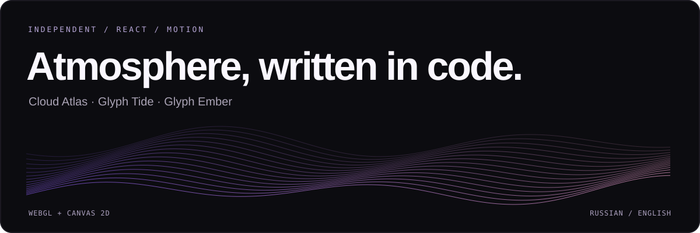

<p align="center">
  <strong>Русский</strong> · <a href="README.en.md">English</a>
</p>



<p align="center">
  <a href="https://github.com/morokaze/reactbitsprocomponents/actions/workflows/check.yml"></a>
  <a href="LICENSE"></a>
  
  
</p>

<p align="center">
  Облака, приливы и пламя — три самостоятельных компонента для React.<br>
  Настраиваемое движение, интерактивные демо и исходники без комментариев.
</p>

<p align="center">
  <a href="#компоненты">Компоненты</a> ·
  <a href="#быстрый-старт">Запуск</a> ·
  <a href="#использование">Подключение</a> ·
  <a href="docs/CLEAN_ROOM.md">Clean-room подход</a>
</p>

---

## Компоненты

| Компонент | Что делает | Особенности |
| :--- | :--- | :--- |
| **[Cloud Atlas ↗](components/cloud-atlas)** | Фиолетовые облака поднимаются и вытягиваются словно пламя | WebGL · размытие от курсора · плавное восстановление |
| **[Glyph Tide ↗](components/glyph-tide)** | Прилив из символов затопляет берег и отступает | Canvas 2D · пена и влажный песок · без реакции на курсор |
| **[Glyph Ember ↗](components/glyph-ember)** | Языки ASCII-пламени растут над светящимся основанием | Canvas 2D · искры · опциональное гашение и вспышки |

Каждый компонент находится в отдельном Next.js-проекте. Цвета, скорость и остальные параметры можно менять в демо или через props. Документация коллекции доступна на двух языках; интерфейсы демо — на русском.

<details>
<summary><strong>Посмотреть демо Glyph Ember</strong></summary>


Скриншот показывает реализацию из этого репозитория.

</details>

## Быстрый старт

**Нужны Node.js 22 и npm.** API-ключи и переменные окружения не требуются.

```bash
git clone https://github.com/morokaze/reactbitsprocomponents.git
cd reactbitsprocomponents
npm ci
npm run dev:ember
```

| Запустить | Команда | Локальный адрес |
| :--- | :--- | :--- |
| Cloud Atlas | `npm run dev:cloud` | [localhost:3000](http://localhost:3000) |
| Glyph Tide | `npm run dev:tide` | [localhost:3001](http://localhost:3001) |
| Glyph Ember | `npm run dev:ember` | [localhost:3002](http://localhost:3002) |

Для одновременного запуска используйте отдельные терминалы. `npm run dev` открывает сервер Glyph Ember по умолчанию.

## Использование

1. Скопируйте папку нужного эффекта из `components/<имя>/src/components/<имя>` в свой проект.
2. Установите `gsap` и подключите Tailwind CSS.
3. Задайте компоненту явную высоту контейнера.

```tsx
import GlyphEmber from './components/glyph-ember/GlyphEmber';

export default function Hero() {
  return (
    <GlyphEmber
      colors={['#7B3DFF', '#FF7AD9']}
      interactive={false}
      style={{ width: '100%', height: 600 }}
    />
  );
}
```

Полный API каждого эффекта находится в его `types.ts`; примеры и ограничения — в README компонента. Cloud Atlas также использует CSS-резервный фон из своего `globals.css`.

## Проверки и сборка

```bash
npm run typecheck
npm run build
```

Обе команды работают со **всей коллекцией**. GitHub Actions повторяет установку, проверку типов и сборку на push и pull request. Внешний вид и плавность движения проверяются отдельно в браузере.

<details>
<summary><strong>Запуск production-версий и структура проекта</strong></summary>

После сборки выберите нужную команду; для нескольких демо используйте разные терминалы:

```bash
npm run start --workspace=cloud-atlas
npm run start --workspace=glyph-tide
npm run start --workspace=glyph-ember
```

```text
components/
  cloud-atlas/      WebGL-облака и настройки
  glyph-tide/       ASCII-прилив и настройки
  glyph-ember/      ASCII-пламя и настройки
docs/
  CLEAN_ROOM.md     Подход и границы утверждений
  CLEAN_ROOM.en.md  Английская версия
.github/workflows/ Общая проверка
package-lock.json  Единый lock-файл
```

Служебные `next-env.d.ts`, `.next`, `node_modules` и секреты не публикуются. Next.js может создавать комментарии в генерируемых файлах; собственные исходники их не содержат.

</details>

## Независимая реализация

**Публичный результат → наблюдения → собственный код → визуальное сравнение.**

Визуальными референсами служили публичные демо React Bits. Реализации написаны самостоятельно по наблюдаемому поведению и публичным параметрам; закрытый исходный код не использовался. Это не официальный проект React Bits, и покадровое совпадение не заявляется.

Термин *clean-room* здесь описывает принцип работы с референсом. Формальная процедура с независимыми командами наблюдения и реализации не проводилась. Подробнее: **[подход, источники и ограничения](docs/CLEAN_ROOM.md)**.

## Участие и лицензии

Идеи и ошибки — в [Issues](https://github.com/morokaze/reactbitsprocomponents/issues). Перед изменениями прочитайте [правила участия](CONTRIBUTING.md).

Собственный код распространяется по **[MIT](LICENSE)**. Лицензии зависимостей действуют отдельно; GSAP использует свою Standard License. См. [сторонние зависимости](THIRD_PARTY_NOTICES.md).
