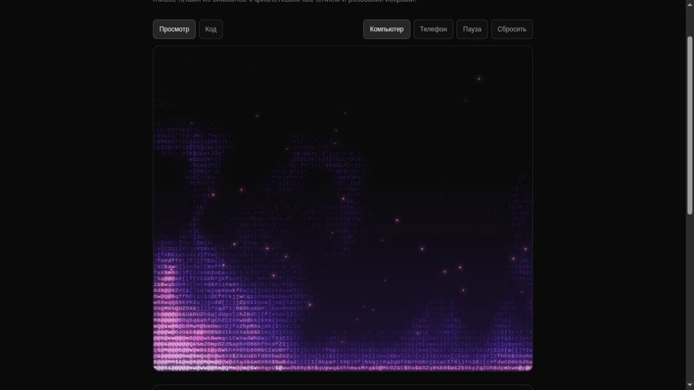

# Glyph Ember

Анимированное ASCII-пламя для React: фиолетовые языки огня, розовые искры и светящееся основание. Цвета, символы, движение и взаимодействие настраиваются через props или русскоязычное демо.

Стек: **Next.js · React · TypeScript · Tailwind CSS · GSAP · Canvas 2D**.



## Быстрый старт

Из корня репозитория с Node.js 22:

```bash
npm ci
npm run dev:ember
```

Демо: http://localhost:3002. Для другого порта запустите из этой папки `npm run dev -- --port 3003`.

## Возможности

- Процедурное пламя и поднимающиеся искры.
- Настраиваемая палитра, свечение, набор символов и плотность сетки.
- Режимы свечения и чернил, автоматический выбор по яркости фона.
- Опциональные гашение при наведении и вспышка по нажатию.
- Пауза, поддержка `prefers-reduced-motion`, остановка вне видимой области.
- Автоматическое изменение размера Canvas под контейнер.
- Копирование готового примера с текущими настройками из вкладки «Код».

## Подключение компонента

Скопируйте всю папку `src/components/glyph-ember` в React-проект с Tailwind CSS и установите GSAP:

```bash
npm install gsap
```

```tsx
import GlyphEmber from './components/glyph-ember/GlyphEmber';

export default function Fire() {
  return (
    <GlyphEmber
      colors={['#7B3DFF', '#FF7AD9']}
      backgroundColor="#0A0A0A"
      interactive={false}
      style={{ width: '100%', height: 600 }}
    />
  );
}
```

Компонент содержит директиву `'use client'`. Для использования ref или обработчиков родительский компонент в Next.js также должен быть клиентским. Задавайте высоту контейнера явно; минимальная высота самого компонента — 240 px.

## Параметры

Все параметры необязательны. Полные типы и значения по умолчанию находятся в [`types.ts`](src/components/glyph-ember/types.ts).

| Параметр | По умолчанию | Назначение |
|---|---|---|
| `colors` | `['#7B3DFF', '#FF7AD9']` | Цвет пламени и горячего основания |
| `backgroundColor` | `'#0A0A0A'` | Фон |
| `mode` | `'auto'` | `'auto'`, `'glow'` или `'ink'` |
| `charset` | Плотный ASCII-набор | Символы для отрисовки, до 128 уникальных |
| `fontFamily` | Системный monospace | Семейство шрифта |
| `glyphSize` | `11` | Размер сетки символов, 6–32 |
| `spacing` | `1` | Горизонтальный интервал, 0.6–3 |
| `height` | `0.45` | Относительная высота пламени, 0.1–1.1 |
| `fuel` | `1` | Количество топлива, 0–2 |
| `turbulence` | `0.6` | Искажение потоков, 0–2 |
| `wind` | `0.15` | Направление и сила ветра, −1–1 |
| `flicker` | `0.5` | Мерцание, 0–1 |
| `sparks` | `0.5` | Количество искр, 0–1 |
| `smoke` | `0.35` | Выраженность дыма, 0–1 |
| `pulse` | `0` | Пульсация, 0–1 |
| `speed` | `1` | Скорость времени, 0–3; 0 останавливает анимацию |
| `glow` | `0.35` | Свечение, 0–2 в демо |
| `intensity` | `1` | Яркость, 0.2–3 в демо |
| `quality` | `1` | Масштаб разрешения Canvas, 0.25–1 |
| `interactive` | `false` | Включить взаимодействие |
| `snuff` | `true` | Гасить огонь под курсором |
| `snuffRadius` | `70` | Радиус гашения в пикселях |
| `snuffStrength` | `0.8` | Сила гашения, 0–1 |
| `clickStoke` | `true` | Вспышка по нажатию |
| `stokeStrength` | `1` | Сила вспышки, 0–3 |
| `paused` | `false` | Остановить время |
| `className`, `style` | — | Оформление контейнера |
| `children` | — | Содержимое поверх эффекта |
| `ref` | — | Доступ к методу `stoke(x)` |

Цвета задавайте в формате `#RGB` или `#RRGGBB`. Диапазоны в таблице предназначены для настройки; не все параметры автоматически ограничиваются при передаче через props.

### Вспышка через ref

```tsx
'use client';

import { useRef } from 'react';
import GlyphEmber, { type EmberHandle } from './components/glyph-ember/GlyphEmber';

export default function Fire() {
  const ref = useRef<EmberHandle>(null);

  return (
    <div>
      <button onClick={() => ref.current?.stoke(0.5)}>
        Вспышка по центру
      </button>
      <GlyphEmber ref={ref} style={{ height: 600 }} />
    </div>
  );
}
```

`stoke(x)` принимает относительную координату от 0 до 1. При паузе или включённом уменьшении движения вспышка не запускается.

## Разработка и проверка

```bash
npm run typecheck
npm run build
npm start
```

GitHub Actions запускает установку из lock-файла, проверку типов и production-сборку при push и pull request. Это технические проверки; внешний вид и плавность анимации проверяются в браузере отдельно.

`next-env.d.ts` и `.next` создаются Next.js автоматически и не входят в репозиторий. В собственных исходниках комментариев нет; служебные файлы Next.js могут содержать сгенерированные комментарии.

## Структура

```text
src/
  app/                         Страница демо и общие стили
  components/
    EmberPlayground.tsx        Русскоязычные настройки
    glyph-ember/
      GlyphEmber.tsx           Компонент и цикл отрисовки
      math.ts                  Шум и преобразование цветов
      types.ts                 Props и значения по умолчанию
../../.github/workflows/check.yml   Проверка на GitHub
```

## Происхождение и лицензия

Независимая реализация по публичному визуальному референсу Glyph Ember от React Bits. Проект не связан с React Bits; закрытый исходный код не использовался. Покадровое совпадение с оригиналом не заявляется.

Собственный код — [MIT](../../LICENSE). Зависимости имеют отдельные лицензии, в том числе GSAP: см. [сторонние зависимости](../../THIRD_PARTY_NOTICES.md). Стандартный юридический текст MIT сохранён на английском.

Правила участия: [CONTRIBUTING.md](../../CONTRIBUTING.md).
